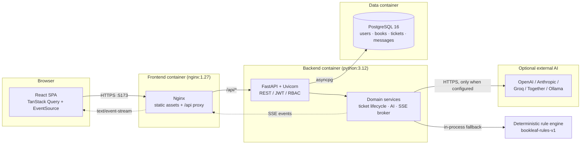
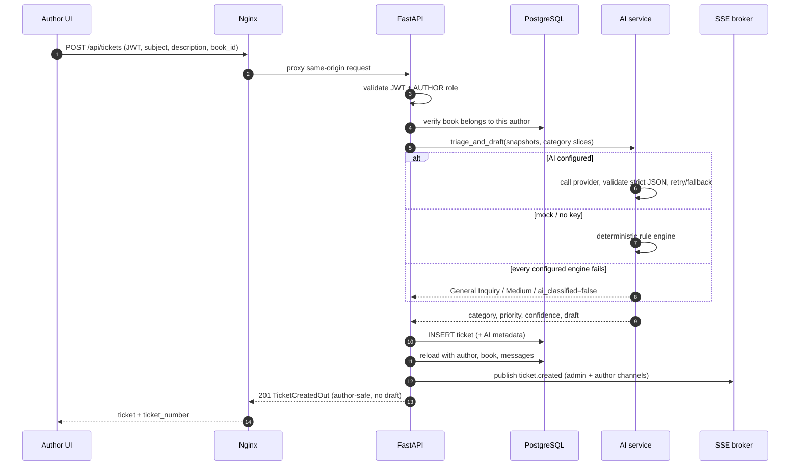
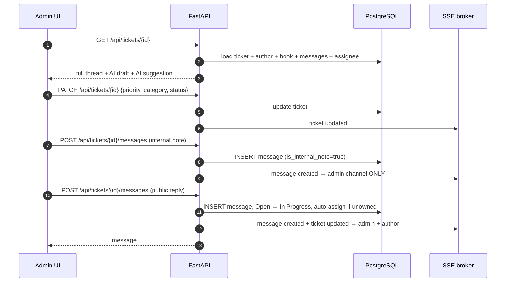
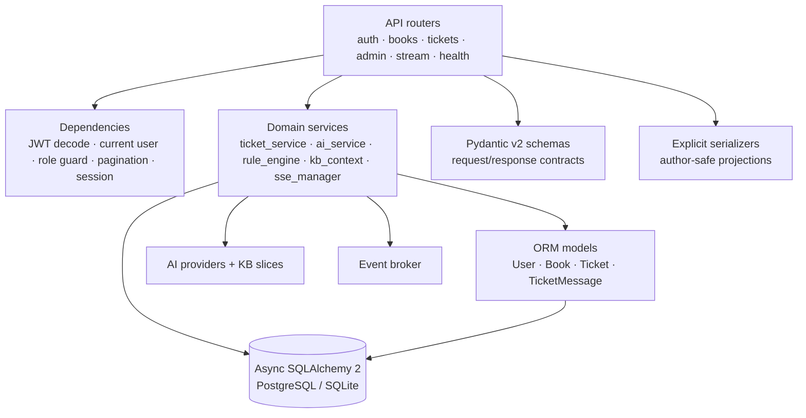
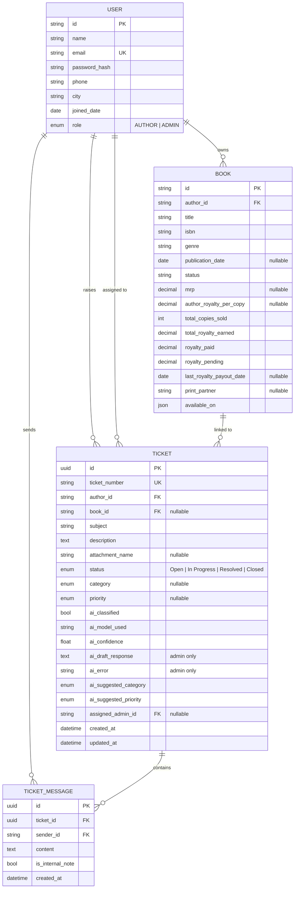
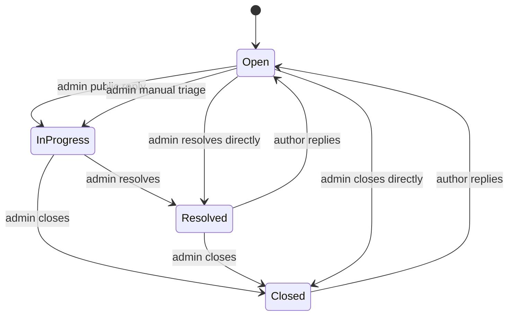
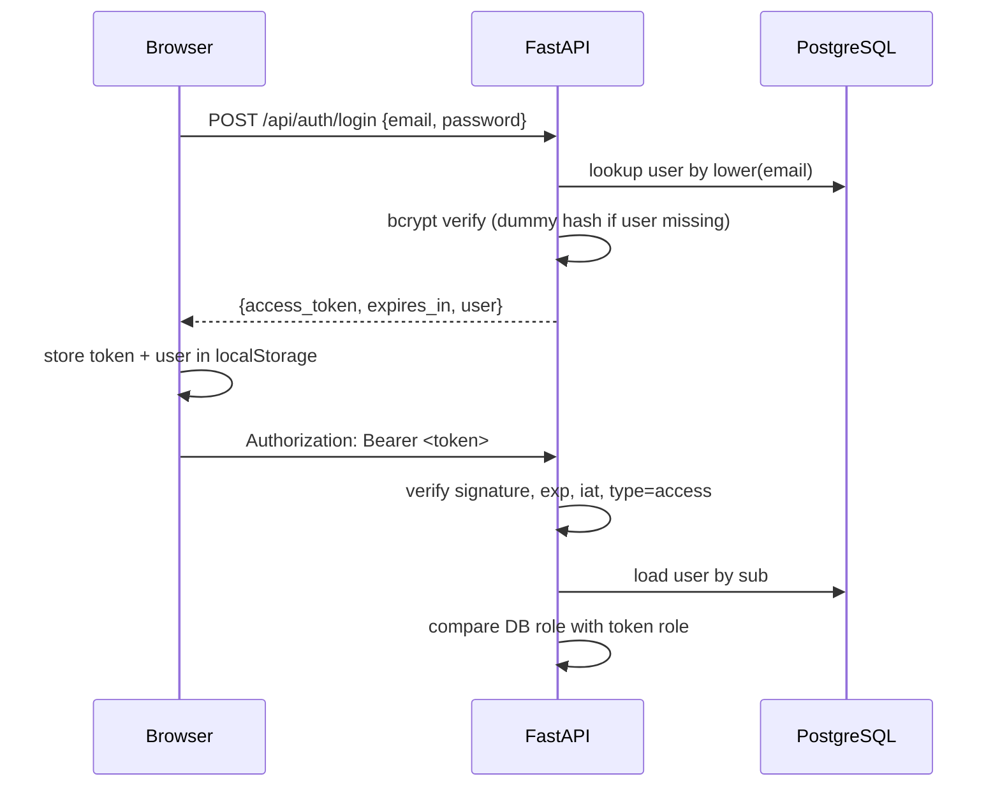
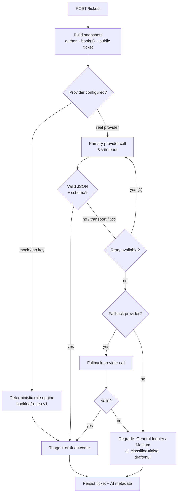

# BookLeaf Portal — Architecture & Working Guide

This guide explains **how the BookLeaf Author Support & Communication Portal works**, from
the browser request to the database row, why the code is organised the way it is, and how to
operate, test and extend it.

It is written for someone reviewing the assignment, onboarding onto the codebase, or preparing
to demo the product.

> Quick links: [Product overview](#1-product-overview) · [System topology](#2-system-topology) ·
> [Request flows](#3-end-to-end-request-flows) · [Data model](#5-data-model) ·
> [AI subsystem](#9-aislm-subsystem) · [Realtime](#10-realtime-subsystem) ·
> [Frontend](#11-frontend-architecture) · [Deployment](#13-deployment-and-operations) ·
> [Testing](#14-testing-and-verification) · [Demo script](#18-five-minute-demo-script)

---

## 1. Product overview

BookLeaf Publishing is a self-publishing company. Authors need a single place to ask about
royalties, print quality, ISBN/metadata, distribution and book-production progress. Support
staff need to answer quickly **with the author's and book's context already in front of them**,
without ever exposing internal notes or AI-generated drafts to the author.

The portal has two experiences over one API:

| Persona | Entry point | What they do |
| --- | --- | --- |
| **Author** | `/app` | See their books and royalties, raise a request, follow the thread, reply |
| **Support admin** | `/admin` | Work the queue, filter/sort by urgency, read context, triage, reply, add internal notes, regenerate AI drafts, browse the author portfolio |

The core product invariant is **asymmetric visibility**:

- an author can only ever see **their own** tickets;
- an author never receives **internal notes**;
- an author never receives **`ai_draft_response`** (or the internal AI error);
- admins see the complete thread and the draft.

That invariant is enforced **server-side** in one serialization layer, not by hiding fields in
React.

### Primary use cases

1. Author raises a royalty dispute → AI classifies it as `Critical` / `Royalty & Payments` and
   drafts a reply → admin reviews the draft with the book’s pending-royalty context → replies.
2. Author reports blurred print → admin sees the book, print partner and production stage →
   adds an internal note for the print team → sends a public reply.
3. An in-production book has `null` MRP/royalty/publication date → the UI renders it safely
   instead of showing `₹0`, `null` or a broken card.
4. A royalty balance below ₹1,000 is rolled over, not lost → the author sees an explanatory
   tooltip rather than a misleading “pending” figure.
5. AI is unavailable → the ticket is still created with `General Inquiry` / `Medium` and an
   admin-facing **“AI Offline - Manual Triage Required”** state; the author is never blocked.

---

## 2. System topology

The repository is a monorepo with two deployable units plus PostgreSQL. Nginx serves the
compiled SPA and reverse-proxies `/api/*` to FastAPI, so browser traffic is same-origin.



### Deployment units

| Unit | Image / runtime | Host port | Responsibility |
| --- | --- | --- | --- |
| `db` | `postgres:16-alpine` | internal `5432` | Durable storage, named volume `bookleaf_pgdata` |
| `backend` | `backend/Dockerfile` (Python 3.12-slim) | `8000` | Alembic migration → idempotent seed → Uvicorn |
| `frontend` | `frontend/Dockerfile` (Node build → nginx) | `5173 → 80` | Static SPA, `/api` proxy, unbuffered SSE |

### Why this shape

- **One API, two clients-in-one** keeps authorization and serialization in a single place.
- **Nginx same-origin proxy** removes CORS complexity in production and lets `EventSource`
  send the JWT as a query parameter without exposing a second public origin.
- **Postgres as the only stateful service** keeps local setup and deployment simple.
- **AI is an outbound dependency, never on the critical write path**: a failure degrades the
  ticket, it does not lose it.

---

## 3. End-to-end request flows

### 3.1 Author creates a ticket



Key points:

- The **AI call happens before the insert** so the created ticket already carries triage.
- The **draft is persisted** on the ticket but the author-facing serializer sets
  `ai_draft_response = None`.
- A book supplied with the ticket must belong to the author, otherwise `404 book_not_found`.
- Ticket numbers are human-readable (`TKT-1005`) while the primary key is a UUID.
- The insert is retried up to five times on a ticket-number collision; the expensive AI call
  is not repeated.
- `attachment_name` is a display name only — paths are stripped, and no file is uploaded.

### 3.2 Admin triages and replies



Triage overrides preserve the model's original opinion (`ai_suggested_category`,
`ai_suggested_priority`). The UI computes a provenance badge:

| Condition | Badge |
| --- | --- |
| `ai_classified=false` | Manual fallback / AI offline |
| `ai_model_used` starts with `bookleaf-rules` | AI triaged (rules) |
| Current category/priority differs from suggestion | Admin override |
| Real model and no override | AI triaged |

### 3.3 Author replies and reopens

An author reply to a `Resolved` or `Closed` ticket moves it back to `Open` and notifies both
channels. This is deliberate: an author should not have to create a new ticket to continue the
same conversation.

### 3.4 Live updates

The SPA opens `GET /api/stream?token=<JWT>` after login. On any event it invalidates the
relevant TanStack Query caches, so the queue/thread refetches. Polling every 30 seconds remains
as a fallback if SSE is blocked by a proxy.

---

## 4. Backend architecture

### 4.1 Layers



| Layer | Files | Rule |
| --- | --- | --- |
| Routers | `app/api/*.py` | HTTP concerns only: parse, authorize, call service, serialize |
| Dependencies | `app/api/deps.py` | JWT → DB user, role guards, pagination, SSE token |
| Services | `app/services/*.py` | All business invariants and orchestration |
| Models | `app/models/*.py` | Persistence shape, relationships, indexes |
| Schemas | `app/schemas/*.py` | Validation and API contracts |
| Serializers | `app/api/serializers.py` | The single place that decides admin vs author visibility |
| Config | `app/config.py` | Typed environment settings, secret redaction |
| Infra | `database.py`, `security.py`, `errors.py`, `logging_config.py` | Engine, hashing/JWT, error envelope, request IDs |

### 4.2 HTTP request lifecycle

```mermaid
flowchart LR
    A[Request] --> B[Request-ID middleware]
    B --> C[CORS / GZip]
    C --> D[Router + dependencies]
    D --> E[JWT verification]
    E --> F[Role check]
    F --> G[AsyncSession]
    G --> H[Service layer]
    H --> I[Commit]
    I --> J[Explicit serializer]
    J --> K[JSON response]
    K --> L[X-Request-ID + timing + security headers]
```



- Every response carries `X-Request-ID` and `X-Response-Time-ms`.
- Logs are correlated through a context variable; `/api/stream` is excluded from per-request
  logging because it is long-lived.
- Security headers (`X-Content-Type-Options`, `X-Frame-Options`, `Referrer-Policy`) are added
  centrally.
- Errors use a stable envelope:

```json
{
  "error": {
    "code": "ticket_not_found",
    "message": "Ticket not found.",
    "details": null,
    "request_id": "..."
  }
}
```

### 4.3 Session and relationship strategy

- `expire_on_commit=False` keeps objects usable after commit, but it also means relationships
  must be kept in sync manually when changed. `assign/unassign` updates both
  `ticket.assigned_admin_id` and the loaded `assigned_admin` object — this prevents a stale
  owner appearing in the API response.
- `selectinload` is used for author, book, assignee and messages (plus each message sender) to
  avoid N+1 queries and async lazy-load errors.
- The session dependency rolls back uncommitted work if an exception escapes.
- All timestamps are stored in UTC through a custom `UTCDateTime` type, which also normalises
  SQLite values (SQLite has no native timezone-aware datetime).

### 4.4 Ticket number allocation

`TKT-1001` is the initial sequence. New numbers are `max(numeric suffix) + 1`. A unique index on
`ticket_number` protects correctness; collisions are retried five times before returning `503`.
This is sufficient for a single-writer support desk. For horizontally scaled writes, a database
sequence or a dedicated numbering table would be the next step.

---

## 5. Data model



### Models

- **User** — one table for authors and admins. IDs are stable strings from the sample data
  (`AUTH007`, `ADMIN001`), emails are unique, passwords are bcrypt hashes.
- **Book** — only `title`, `isbn` and `status` are mandatory. Commercial fields are nullable
  because a book in production genuinely has no MRP, royalty or publication date yet.
  `is_in_production`, `production_stage`, `production_stage_index` and `next_production_stage`
  are derived properties, not stored duplication.
- **Ticket** — current workflow state plus AI provenance. `ai_suggested_*` stores what the
  model proposed so an admin override can be shown without losing the original classification.
- **TicketMessage** — public reply or internal note. There is no soft-delete; notes are
  filtered at serialization and never sent to an author channel.

### Indexes

| Index | Why |
| --- | --- |
| `tickets(status, priority, created_at)` | Admin queue filtering and urgency sort |
| `tickets(author_id, status)` | Author dashboard/list |
| `ticket_messages(ticket_id, created_at)` | Ordered thread load |
| `users(email)` unique | Login lookup |
| individual FK/status/category/priority indexes | Filter selectivity |

### Enumerations

- **Status:** `Open`, `In Progress`, `Resolved`, `Closed`
- **Category:** `Royalty & Payments`, `ISBN & Metadata`, `Printing & Quality`,
  `Distribution & Availability`, `Book Status & Production Updates`, `General Inquiry`
- **Priority:** `Critical`, `High`, `Medium`, `Low`
- **Role:** `AUTHOR`, `ADMIN`

Enums are stored as validated strings (`native_enum=False`), which keeps migrations portable
across PostgreSQL and SQLite.

### Null-safe book data

`BookCard` and the context panel branch on `is_in_production` and guard every monetary/date
field. A missing MRP renders as “—”, not `₹0`; the royalty tooltip only appears when a numeric
balance exists and is below ₹1,000. This is a product requirement, not just a rendering detail.

---

## 6. Domain rules and state machine

### 6.1 Ticket lifecycle



The API allows an admin to set any status through `PATCH` (useful for corrections). The diagram
shows the normal, automatic transitions.

### 6.2 Automatic rules

| Trigger | Effect | Why |
| --- | --- | --- |
| Admin posts first **public** reply on `Open` | Status → `In Progress` | The conversation has started |
| Admin posts any public reply on an unassigned ticket | Assignee → that admin | Picking up work implies ownership |
| Admin posts an **internal note** | No status change, no auto-assignment | Notes are not a reply to the author |
| Author posts on `Resolved`/`Closed` | Status → `Open` | Continue the same conversation |
| Author posts an internal note | `403 internal_note_forbidden` | Notes are an admin tool |
| Admin assigns a non-admin | `422 invalid_assignee` | Ownership must be a support agent |
| Admin sets `assigned_admin_id: null` | Unassign | Explicit queue hand-back |

### 6.3 Urgency ordering

Admin list ordering is:

1. unresolved (`Open`/`In Progress`) before resolved/closed;
2. `Critical` → `High` → `Medium` → `Low` (nulls last);
3. oldest first within the same bucket.

This is implemented in SQL (`CASE` expressions), not in the browser, so pagination stays
consistent. Author lists are simply newest first.

### 6.4 Filters

`GET /api/tickets` accepts `status`, `category`, `priority`, `date_from`, `date_to`, `q`
(subject/description/ticket number), `unassigned`, `mine`, `page`, `page_size` (max 100).

Date filters are **calendar days in `DISPLAY_TIMEZONE`** (default `Asia/Kolkata`) and are
converted to UTC half-open bounds. `date_to` is exclusive at the start of the next local day.
`date_from > date_to` returns `422`.

---

## 7. Authentication, authorization and security

### 7.1 Login and JWT



- HS256, 24-hour expiry by default.
- Payload: `sub`, `role`, `type=access`, `iat`, `exp`.
- The role is re-checked against the database on every request. A role change invalidates
  existing tokens (`401 token_role_mismatch`).
- Login uses a dummy hash for unknown emails so response timing does not reveal account
  existence.
- Passwords are bcrypt with cost 12; passwords over 72 bytes are rejected because bcrypt would
  silently truncate them.

### 7.2 Permission matrix

| Capability | Public | Author | Admin |
| --- | --- | --- | --- |
| `POST /auth/login` | ✅ | ✅ | ✅ |
| `GET /health`, `/health/ready` | ✅ | ✅ | ✅ |
| `GET /auth/me` | ❌ | ✅ | ✅ |
| `GET /books` | ❌ | own books | all / filter by author |
| `POST /tickets` | ❌ | ✅ | ❌ (`403`) |
| `GET /tickets` | ❌ | own only | all + filters |
| `GET /tickets/{id}` | ❌ | own only | any |
| `PATCH /tickets/{id}` | ❌ | ❌ | ✅ |
| `POST /tickets/{id}/messages` | ❌ | own, public only | any, public or internal |
| `POST /tickets/{id}/regenerate-draft` | ❌ | ❌ | ✅ |
| `GET /admin/*` | ❌ | ❌ | ✅ |
| `GET /stream` | ❌ | own author channel | admin channel |

### 7.3 Isolation choices

- Another author’s ticket returns **404**, not 403, so existence is not confirmed.
- The role guards (`require_admin`, `require_author`) are dependencies, so a route cannot
  accidentally omit them.
- Author scoping is applied in the service query (`author_id=user.id`), not by filtering a
  full result set in memory.
- The queue’s `unassigned` and `mine` flags are **ignored for authors**, and `mine` is only
  translated to an assignee filter for admins.
- The SSE token is passed as `?token=` because the browser `EventSource` API cannot set an
  `Authorization` header. It is still a normal signed JWT with the same expiry. This is a
  deliberate trade-off; production should use short-lived stream tokens or a cookie.

### 7.4 The visibility invariant

`app/api/serializers.py` is the authoritative boundary:

```python
# Author response
ai_draft_response = ticket.ai_draft_response if admin else None
ai_error = ticket.ai_error if admin else None
messages = all messages if admin else [m for m in messages if not m.is_internal_note]
```

The author `message_count` and `last_message_at` are computed from **visible** messages, so even
metadata does not reveal that an internal note exists.

SSE is a second, independent boundary:

- authors subscribe only to `author:<their-id>`;
- admins subscribe to the shared `admin` channel;
- internal-note events are published to `admin` only;
- every SSE payload is **metadata only** — no subject, description or message body.

Both boundaries are covered by tests.

### 7.5 Other hardening already present

- CORS restricted by configuration.
- GZip for responses over 800 bytes.
- `X-Content-Type-Options: nosniff`, `X-Frame-Options: DENY`, referrer policy.
- No secrets in health/AI responses; `SecretStr` for keys.
- Startup warning if the development JWT secret is used in production.
- SQLAlchemy parameter binding (no string-built SQL).
- Bcrypt cost 12 and 72-byte guard.

### 7.6 Deliberate gaps (documented, not hidden)

- JWT is stored in `localStorage` (simple for a demo; XSS-sensitive). An httpOnly cookie with
  CSRF protection is the production hardening step.
- No rate limiting on login/ticket creation; put it at the edge or add SlowAPI.
- No attachment upload/storage — only a sanitized display name is stored.
- No audit log table for internal-note reads or triage changes.
- No email notifications; realtime is in-app only.

---

## 8. API design

Base prefix: `/api`. Interactive docs: `/docs`; OpenAPI: `/openapi.json`.

| Method | Path | Access | Purpose |
| --- | --- | --- | --- |
| `POST` | `/auth/login` | public | Email/password → JWT |
| `GET` | `/auth/me` | authenticated | Current user |
| `GET` | `/books` | authenticated | Author’s books; admin may filter by `author_id` |
| `GET` | `/books/{id}` | authenticated | One visible book |
| `POST` | `/tickets` | author | Create ticket + synchronous triage/draft |
| `GET` | `/tickets` | authenticated | Role-scoped list + filters + pagination |
| `GET` | `/tickets/{id}` | authenticated | Detail + thread (author-safe) |
| `PATCH` | `/tickets/{id}` | admin | Status/category/priority/assignee |
| `POST` | `/tickets/{id}/messages` | authenticated | Public reply or admin internal note |
| `POST` | `/tickets/{id}/regenerate-draft` | admin | Regenerate, optional category/instruction |
| `GET` | `/admin/stats` | admin | Queue KPIs + pending royalty total |
| `GET` | `/admin/authors` | admin | Author portfolio |
| `GET` | `/admin/ai/health` | admin | Provider mode + usage counters |
| `GET` | `/stream?token=...` | authenticated | SSE stream |
| `GET` | `/health` | public | Liveness + runtime summary |
| `GET` | `/health/ready` | public | Database readiness |

### Conventions

- JSON in, JSON out; UUIDs for ticket IDs, human numbers for display.
- Validation errors use FastAPI’s `422`, wrapped in the same error envelope by the exception
  handlers.
- Pagination is `{items, total, page, page_size, pages}`.
- `POST /tickets` returns `201`; `POST /messages` returns `201`.
- `regenerate-draft` returns `503 ai_unavailable` if the provider fails, and **keeps the
  previous draft**.
- Health endpoints intentionally expose the provider mode and counters but never keys.

### Why the client never sends derived data

The browser sends `book_id`, `subject`, `description` and an optional display attachment name.
It does not send category, priority, assignee or timestamps. The server owns numbering, status,
triage and ownership. This prevents a compromised or buggy client from forging workflow state.

---

## 9. AI/SLM subsystem

### 9.1 Pipeline



Important distinction:

- **No usable provider** (mock mode, or a real provider without credentials) → rule engine
  performs real deterministic triage and drafting.
- **A configured provider fails** → do **not** pretend a model answered. Degrade to
  `General Inquiry` / `Medium`, no draft, `ai_classified=false`, with a short admin-only error.
  This is what drives the “AI Offline - Manual Triage Required” state.

### 9.2 Provider factory

| `AI_PROVIDER` | Transport | Needs key? | Typical use |
| --- | --- | --- | --- |
| `mock` | Local rule engine | No | Offline demo, tests |
| `openai` | OpenAI Chat Completions | Yes | Hosted frontier/cheap model |
| `anthropic` | Anthropic Messages API | Yes | Claude family |
| `slm_cloud` | OpenAI-compatible (Groq/Together) | Yes | Hosted small model |
| `slm_local` | OpenAI-compatible (Ollama/vLLM) | No | On-prem small model |

`ProviderSpec` resolves provider, model, base URL and key. `AI_BASE_URL` and `AI_MODEL` are the
only changes needed to switch between OpenAI, Groq, Together, Ollama and vLLM.

### 9.3 Context construction

The prompt is deliberately small:

1. payout-calendar note for the current date;
2. compact author snapshot (name, city, join date, book count);
3. the linked book, or a compact catalogue summary plus pending-royalty total;
4. subject + truncated public description;
5. shared policy digest + category router + tone contract;
6. **one** category KB slice (~120–180 tokens) for drafting.

Internal notes are never included. The ticket snapshot contains only the public subject and
description. `regenerate-draft` can inject a different category slice without re-sending the
whole handbook.

### 9.4 Strict JSON contract

The model must return a JSON object compatible with `AITriageResult`:

```json
{
  "category": "Royalty & Payments",
  "priority": "Critical",
  "draft_response": "Dear ...",
  "confidence": 0.82,
  "rationale": "..."
}
```

Extraction tolerates markdown fences, surrounding prose, trailing commas and key casing. Values
are validated against the API enums by Pydantic. Invalid output is treated as a provider
failure and retried; it never reaches the database as an unvalidated category.

### 9.5 Resilience knobs

| Setting | Default | Meaning |
| --- | --- | --- |
| `AI_TIMEOUT_SECONDS` | `8` | Per-attempt timeout |
| `AI_MAX_RETRIES` | `1` | Immediate retry on transport/5xx/JSON failure |
| `AI_TOTAL_TIMEOUT_SECONDS` | `20` | Hard ceiling per provider attempt |
| `AI_TWO_PASS` | `false` | Classify cheaply, then draft with one slice |
| `AI_FALLBACK_*` | unset | Optional second engine (e.g. cloud → local) |

### 9.6 Two-pass (optional)

1. A small classification call returns category/priority/confidence (max 200 tokens).
2. A drafting call receives the confirmed category and only that category slice.
3. If classification succeeds but drafting fails, the ticket keeps the useful classification
   and has no draft (`ai_classified=true`, `ai_error` set).

Default is single-pass because it is cheaper and the prompt is already compact.

### 9.7 Regeneration

`POST /tickets/{id}/regenerate-draft`:

- picks the supplied category, else the ticket’s current category, else `General Inquiry`;
- rebuilds context from the author/books and the public ticket description;
- on success replaces draft/model/confidence and clears `ai_error`;
- on failure records the error and returns `503`, **preserving the existing draft** so the
  admin can still reply manually;
- emits `ticket.updated` to the admin channel only.

### 9.8 AI observability

`GET /api/admin/ai/health` and `/api/health` expose:

- provider, model, configured/mode, fallback enabled, two-pass flag;
- calls, failures, retries, prompt/completion tokens, average/last latency, last model.

Counters are in-process and reset on restart. They are enough for a demo and a single-instance
deployment; production should export Prometheus/OpenTelemetry metrics.

### 9.9 Cost rationale (summary)

Standard support replies are short and fall into a handful of categories, which makes them a
good fit for a small hosted model. The cost reduction comes from three levers:

1. **small prompt** — one category slice instead of the whole handbook;
2. **short structured output** — JSON with a bounded draft;
3. **routing** — routine categories on an 8B-class SLM, ambiguous/high-stakes cases on a
   frontier model, with a local fallback.

That combination is typically quoted as roughly **~85% cheaper** than sending every ticket to a
frontier model. The exact number depends on provider pricing and traffic mix, so the app exposes
token/latency counters instead of hard-coding a claim. Full reasoning is in `README.md`.

---

## 10. Realtime subsystem

### 10.1 Channels

| Channel | Subscribers | Receives |
| --- | --- | --- |
| `admin` | every admin session | all ticket/message/status events |
| `author:<id>` | that author’s sessions | only their tickets, public events |

The broker is an in-process `asyncio` pub/sub with a bounded queue per subscriber. Slow
consumers drop the oldest event rather than blocking an API request.

### 10.2 Events

| Event | When | Payload |
| --- | --- | --- |
| `connected` | stream opens | user id, role, channels |
| `ticket.created` | author creates | ticket metadata |
| `ticket.updated` | triage, status, assignment, draft regeneration | ticket metadata |
| `message.created` | reply or internal note | ticket metadata, message id, internal flag, `status_changed` |
| `ping` | heartbeat (15 s) | `{}` |

Payloads deliberately contain **no subject, description or message body**. A leaked stream can
reveal that a ticket changed, not what was said.

### 10.3 Privacy

- An internal note is published to `admin` only; the author channel is not notified at all.
- The author stream cannot subscribe to another author’s channel because the server derives the
  channel from the authenticated user, not from a client-supplied ID.
- Even if an author somehow observed an admin event, the event has no note content.

### 10.4 Client integration

`useRealtime(enabled)`:

1. reads the JWT and opens `EventSource(streamUrl(token))`;
2. tracks `connecting` / `live` / `offline` for the header indicator;
3. on each event invalidates `["tickets"]`, `["admin"]` and the specific `["ticket", id]`;
4. closes the stream on logout/unmount.

TanStack Query also polls lists/details every 30 seconds, so the UI remains correct if SSE is
blocked by a corporate proxy.

### 10.5 Scaling caveat

The broker and AI metrics are process-local. Running multiple Uvicorn workers or backend
replicas would split subscribers and events. For horizontal scaling, replace the broker with
Redis pub/sub (or Postgres `LISTEN/NOTIFY`) and move metrics to a shared backend. The channel
names and event payloads are already abstracted for this change.

---

## 11. Frontend architecture

### 11.1 Route tree

```text
/login                     PublicOnly → demo logins + form
/                          RootRedirect → /admin or /app by role
/app                       ProtectedRoute role=AUTHOR + AppShell
  /                        Author dashboard
  /books                   Book shelf (null-safe cards, royalty tooltip)
  /tickets                 Author ticket list
  /tickets/new             New request form
  /tickets/:id             Author thread
/admin                     ProtectedRoute role=ADMIN + AppShell
  /                        Queue (KPIs, filters, urgency sort)
  /tickets/:id             Split-view workspace
  /authors                 Author portfolio
/author                    Redirect → /app
*                          404
```

### 11.2 Layers

```text
src/
├── pages/          route-level screens (author/*, admin/*, Login, NotFound)
├── components/
│   ├── layout/     AppShell, sidebar, header, live indicator
│   ├── ui/         Button, Card, Badge, Field, Tooltip, Toast, Avatar, Spinner
│   ├── tickets/    TicketBadges, TicketThread, ReplyComposer
│   ├── admin/      QueueRail, ContextPanel, AiDraftPanel
│   └── books/      BookCard
├── hooks/          TanStack queries + useRealtime
├── auth/           AuthContext, ProtectedRoute/PublicOnly/RootRedirect
└── lib/            fetch client, types, constants, formatting, document title
```

### 11.3 Auth bootstrapping

- `AuthContext` hydrates from `localStorage` immediately, then calls `/auth/me` to validate the
  token and refresh the user.
- A global `bookleaf:unauthorized` event is dispatched by the API client on `401`; the context
  clears the session and the route guards redirect to `/login`.
- `ProtectedRoute` waits for the bootstrap to finish before deciding, avoiding a login flash.
- `PublicOnly` sends an already-authenticated user to their role home.

### 11.4 Server state

TanStack Query owns all server data; there is no global Redux store.

| Key | Used by | Refresh |
| --- | --- | --- |
| `["tickets", filters]` | queue/list | SSE invalidation + 30 s poll |
| `["ticket", id]` | thread/workspace | SSE invalidation + 30 s poll |
| `["books", authorId]` | book shelf/new request | 60 s stale time |
| `["admin", "stats"]` | KPIs | SSE invalidation |
| `["admin", "authors"]` | portfolio | 60 s stale time |
| `["admin", "ai-health"]` | AI desk panel | 30 s stale time |

Mutations update the detail cache directly (`setQueryData`) and invalidate list/stats queries.
This makes the reply composer feel instant while keeping the queue consistent.

### 11.5 Admin workspace composition

`AdminTicketWorkspacePage` is a three-part layout:

1. **Queue rail** — the surrounding queue for quick switching;
2. **Conversation** — ticket header, thread, composer with Public reply / Internal note tabs;
3. **Context sidebar** — author card, book card (royalties, production stage, channels), triage
   selectors, and the AI draft assistant.

The AI panel supports:

- showing the draft and confidence/source;
- editing it locally;
- **Use in reply** to copy it into the composer;
- **Regenerate** with a category and optional instruction;
- an explicit “AI Offline - Manual Triage Required” banner when there is no usable draft.

Drafts are never auto-sent. The human explicitly reviews and sends.

### 11.6 Author experience details

- Dashboard KPI cards: open requests, pending royalty, published titles, in production.
- Book cards guard every nullable field and show the ₹1,000 rollover tooltip only when the
  pending amount is below the threshold.
- New request form can be pre-filled with a book from the shelf (`/app/tickets/new?book=BK013`).
- Ticket detail renders only public messages (the server already removed notes) and a reply box.
- The author never sees a draft panel or an internal-note tab.

### 11.7 UI system

- Tailwind with a BookLeaf palette (deep green, cream, amber accents).
- Shared primitives keep spacing, borders, focus rings and disabled states consistent.
- `useDocumentTitle` keeps the browser tab in sync with the route.
- Toasts confirm mutations and surface API errors.
- Mobile queue collapses into stacked cards; the admin rail is hidden at small widths.

---

## 12. Seed data and demo dataset

`python -m app.seed` loads `backend/data/bookleaf_sample_data.json`:

- **10 authors**, **18 books**;
- one admin (`admin@bookleaf.com`);
- **4 demo tickets**, each chosen to exercise a different edge case.

| Ticket | Author | Scenario | Why it exists |
| --- | --- | --- | --- |
| `TKT-1001` | Rohit Kapoor | Overdue royalty across two books, **Critical**, has an internal finance note | Tests AI draft, internal-note privacy, urgency sort |
| `TKT-1002` | Priya Sharma | Blurred print/misalignment, **High**, public reply + internal QA note | Tests split thread and print context |
| `TKT-1003` | Meera Nair | Amazon “Currently Unavailable”, **High**, **AI offline** | Tests manual triage banner + regenerate |
| `TKT-1004` | Kavita Deshmukh | Book stuck in Typesetting, **Medium**, **unassigned** | Tests assignment, production context, null-safe fields |

Seed behavior:

- **idempotent** without flags: authors/books are upserted; demo tickets are only created if
  their ticket number does not already exist;
- `--reset` deletes tickets/messages/books/users and reseeds from scratch;
- `--sample <path>` allows a different sample JSON.

Demo password for every seeded account: `password123`.

The seed is intentionally independent of the AI layer: ticket drafts are hand-written so the
demo is identical with or without API keys.

---

## 13. Deployment and operations

### 13.1 Docker Compose startup order

```text
docker compose up -d --build
  ├─ db starts, waits for pg_isready
  ├─ backend starts after db is healthy:
  │    alembic upgrade head
  │    python -m app.seed
  │    uvicorn app.main:app --host 0.0.0.0 --port 8000 --proxy-headers
  └─ frontend starts after backend is healthy:
       nginx serves /usr/share/nginx/html and proxies /api → backend:8000
```

Verified status:

```text
bookleaf-portal-db-1        Up (healthy)    5432/tcp
bookleaf-portal-backend-1   Up (healthy)    0.0.0.0:8000->8000/tcp
bookleaf-portal-frontend-1  Up (healthy)    0.0.0.0:5173->80/tcp
```

### 13.2 URLs

| What | URL |
| --- | --- |
| Portal | <http://localhost:5173> |
| API docs | <http://localhost:8000/docs> |
| OpenAPI | <http://localhost:8000/openapi.json> |
| Health | <http://localhost:8000/api/health> |
| Readiness | <http://localhost:8000/api/health/ready> |

### 13.3 Configuration groups

| Group | Variables |
| --- | --- |
| App | `ENVIRONMENT`, `DEBUG`, `LOG_LEVEL`, `API_PREFIX`, `CORS_ORIGINS`, `DISPLAY_TIMEZONE` |
| DB | `DATABASE_URL`, `DATABASE_ECHO`, `AUTO_CREATE_TABLES` |
| Auth | `JWT_SECRET`, `JWT_ALGORITHM`, `ACCESS_TOKEN_EXPIRE_MINUTES` |
| Seed | `SEED_DEFAULT_PASSWORD`, `ADMIN_EMAIL`, `ADMIN_PASSWORD`, `ADMIN_ID`, `ADMIN_NAME` |
| AI | `AI_PROVIDER`, `AI_BASE_URL`, `AI_API_KEY`, `AI_MODEL`, timeouts/retries, two-pass, fallback |
| Realtime | `SSE_HEARTBEAT_SECONDS` |

See `backend/.env.example` for four ready-to-use provider presets.

### 13.4 Health and observability

- **Liveness** `/api/health` — process is up, returns version/environment/AI mode/counters.
- **Readiness** `/api/health/ready` — executes `SELECT 1`.
- **AI health** `/api/admin/ai/health` — admin-only counters, no secrets.
- **Request correlation** — `X-Request-ID` on every response and in logs.
- **Timing** — `X-Response-Time-ms` and per-request log line.
- **Docker health checks** — Postgres `pg_isready`, backend HTTP probe, frontend `wget /`.

### 13.5 Production checklist

- Rotate `JWT_SECRET`; never ship the dev default.
- Set `ENVIRONMENT=production`, `DEBUG=false`, `AUTO_CREATE_TABLES=false`.
- Use managed Postgres with backups; run `alembic upgrade head` as a release step.
- Terminate TLS at the ingress; forward `X-Forwarded-*`.
- Keep proxy buffering off for `/api/stream` (the bundled nginx config does this).
- Restrict `CORS_ORIGINS` to the real origin.
- Move AI keys to a secret manager; define data-egress/retention policy.
- Add edge rate limiting for login/ticket creation.
- Add audit logging for internal notes and triage overrides.
- For multiple backend replicas: shared SSE broker (Redis), shared AI metrics, and a safe
  ticket-number allocation strategy.
- Keep `passlib` pinned with `bcrypt==4.0.1` until hashes are migrated.

### 13.6 Known limitations

- No file upload/storage; only a sanitized attachment **name** is persisted.
- No email/push notifications; realtime is in-app only.
- In-process SSE broker and AI metrics assume one backend process.
- No background job queue; AI triage is synchronous on ticket creation (bounded by the 20 s
  total AI budget).
- No rate limiting, audit table, or httpOnly-cookie session yet (documented hardening items).
- Docker build requires network access to pull base images and install packages.

---

## 14. Testing and verification

### 14.1 Test layers

| Layer | Tool | Scope |
| --- | --- | --- |
| Unit / integration | pytest + pytest-asyncio + httpx ASGI | Auth, RBAC, lifecycle, filters, AI degradation, rules, SSE privacy |
| API E2E | httpx against Dockerized Nginx | 73 assertions across the full REST surface + SSE |
| Browser E2E | Headless Chrome via CDP | 25 UI assertions on login, queue, workspace, author pages, mobile |
| Build | `tsc --noEmit` + `vite build` | Type safety and production bundle |
| Migrations | Alembic on SQLite + offline Postgres SQL | Upgrade/check/downgrade loop |

### 14.2 Commands

```powershell
# Backend unit/integration suite
cd backend
..\..\.venv\Scripts\python.exe -m pytest

# Frontend typecheck + production build
cd frontend
npm run build

# Docker stack
cd bookleaf-portal
docker compose up -d --build
docker compose ps
```

On this Windows machine the Docker CLI lives at
`C:\Users\HP\AppData\Local\Programs\DockerDesktop\resources\bin\docker.exe`; add that folder to
`PATH` if `docker` is not recognised in a fresh shell.

### 14.3 Verified results

| Check | Result |
| --- | --- |
| Backend pytest | **41 passed** |
| Docker API + SSE smoke | **73 passed, 0 failed** |
| Browser E2E | **25 passed, 0 failed**, no console/runtime errors |
| Frontend production build | **passed** (tsc + Vite, ~370 kB JS / 104 kB gzip) |
| Container health | db, backend, frontend all **healthy** |
| Seed idempotency | re-run created **0** extra tickets |
| Postgres persistence | data survived application restarts via named volume |

The Docker smoke test verified, among other things:

- Nginx `/api` proxy, SPA deep-link fallback, hashed asset serving;
- invalid password rejection, case-insensitive login, all four demo accounts;
- author book scoping and admin book filtering;
- ticket validation, AI classification, attachment-name sanitization;
- author create response never contains a draft;
- cross-author 404s, author triage/internal-note/admin-route 403s;
- assignment/unassignment, `mine` and `unassigned` filters;
- triage override provenance;
- first-public-reply status transition, author reply reopen;
- draft regeneration;
- status/priority/category/search/date/pagination filters and 422s;
- internal notes and AI drafts absent from author payloads;
- SSE admin/author channel isolation and metadata-only payloads;
- internal-note SSE events invisible to the author stream.

### 14.4 What is intentionally not automated

- Real third-party AI calls (would require keys and spend; provider transport is unit-tested
  with fakes and the degrade path is covered).
- Email delivery (not implemented).
- Load/performance testing.
- Multi-replica SSE behavior (current design is single-process).

---

## 15. Design decisions and trade-offs

| Decision | Why | Trade-off |
| --- | --- | --- |
| Modular monolith | Assignment scope, one deployable, simple transactions | Not independently scalable per domain |
| Explicit serializers | One auditable privacy boundary for notes/drafts | Slightly more code than `model_validate` |
| JWT in localStorage | Simple SPA auth, works with EventSource query token | XSS-sensitive; httpOnly cookies are safer |
| SSE over WebSockets | One-way update stream, native browser reconnect, simple proxy setup | No bidirectional channel; needs shared broker to scale |
| Synchronous AI on create | Ticket is triaged immediately, as the brief expects | Creation latency tied to AI budget (max ~20 s) |
| Rule engine default | Demo works without keys and is deterministic for tests | Not a substitute for a real model’s language quality |
| No rule-engine fallback after a real model fails | Avoid pretending a model answered; surface manual triage | Admin has no draft during provider outage |
| UUID ticket IDs + human numbers | Safe public identifiers + readable support references | Two identifiers to reason about |
| UTC storage + display timezone | Correct ordering and date filters across regions | Conversion logic at the query boundary |
| Denormalised AI suggestion columns | Show “admin override” without losing model opinion | Extra columns; no full model-call history |
| In-process broker/metrics | Zero extra infrastructure for the demo | Single-process only; Redis needed to scale |
| Client-side filtering only for display | Server owns filtering/pagination/authorization | Some client code repeats filter options |

### What I would build next

1. **Outbox + notifications** — email the author on public replies, with retry and delivery
   status, without blocking the API request.
2. **Redis pub/sub** for SSE and shared rate limiting/metrics when running more than one
   backend instance.
3. **Audit log** for internal-note reads, triage overrides, assignments and exports.
4. **Attachment pipeline** — presigned object storage, virus scan, signed download URLs.
5. **AI evaluation harness** — golden tickets per category, regression scoring for drafts,
   prompt/version tracking.
6. **Cookie-based sessions** with CSRF protection and refresh-token rotation.
7. **Background triage** queue for very large volumes, with an optimistic “triaging” UI state.

---

## 16. How to extend the system

### Add a ticket category

1. Add the enum value in `backend/app/models/enums.py`.
2. Add a KB slice in `backend/app/services/kb_context.py`.
3. Add keywords/priority rules in `backend/app/services/rule_engine.py`.
4. Add the UI label/icon mapping in `frontend/src/lib/constants.ts` and badges.
5. Update the AI router/draft system prompt if needed.
6. Generate an Alembic migration only if the enum is stored natively (it is not by default).

### Add an AI provider

1. If it speaks OpenAI Chat Completions, set `AI_PROVIDER=slm_cloud`/`slm_local` plus
   `AI_BASE_URL`/`AI_MODEL` — no code change.
2. If it uses a different protocol, add a `ProviderSpec` branch and a `_complete_*` method in
   `ai_service.py`, then cover it with the JSON-validation tests.

### Change the workflow

- Add status transitions in `ticket_service.add_message` / `update_ticket`.
- Keep the rule in the service, not the router, so both API and future workers share it.
- Add a test for the new transition and its SSE event.

### Scale realtime

- Replace `EventBroker` with Redis pub/sub while keeping `publish`/`subscribe` signatures.
- Keep channel names (`admin`, `author:<id>`) and metadata-only payloads.
- Ensure the proxy still disables buffering.

---

## 17. Code map

```text
backend/
├── app/
│   ├── main.py                 app factory, middleware, lifespan, routers
│   ├── config.py               typed settings, provider readiness, safe summary
│   ├── database.py             async engine, session factory, SQLite handling
│   ├── security.py             bcrypt + JWT issue/decode
│   ├── errors.py               AppError + exception handlers/envelope
│   ├── timeutils.py            display timezone + local-day → UTC bounds
│   ├── seed.py                 idempotent demo seed / --reset
│   ├── api/
│   │   ├── auth.py             login, me
│   │   ├── books.py            author-scoped catalogue
│   │   ├── tickets.py          create/list/detail/update/messages/regenerate
│   │   ├── admin.py            stats, authors, AI health
│   │   ├── stream.py           SSE endpoint + channel selection
│   │   ├── health.py           liveness/readiness
│   │   ├── deps.py             JWT, RBAC, pagination, stream auth
│   │   └── serializers.py      admin vs author projections (privacy boundary)
│   ├── models/                 User, Book, Ticket, TicketMessage, enums, UTC type
│   ├── schemas/                Pydantic request/response contracts
│   └── services/
│       ├── ticket_service.py   lifecycle, filters, stats, SSE publication
│       ├── ai_service.py       provider factory, prompts, JSON, retry/fallback
│       ├── rule_engine.py      deterministic triage + drafts
│       ├── kb_context.py       modular policy slices
│       ├── ai_context.py       compact snapshots + INR/date formatting
│       └── sse_manager.py      in-process broker + event payloads
├── alembic/                    async env + initial migration
├── tests/                      auth/RBAC, tickets, AI/SSE, timezone
└── data/bookleaf_sample_data.json
frontend/
├── src/pages/                  login, author/*, admin/*
├── src/components/             layout, ui, tickets, admin, books
├── src/hooks/                  queries.ts, useRealtime.ts
├── src/auth/                   AuthContext, route guards
├── src/lib/                    api client, types, constants, formatting
├── nginx.conf                  SPA fallback + /api proxy + SSE no-buffering
└── Dockerfile                  Node build → nginx runtime
docker-compose.yml              db + backend + frontend, health checks, volume
```

---

## 18. Five-minute demo script

1. **Login** at `http://localhost:5173` with the one-click **Admin** button.
2. **Queue** — point out the KPI tiles, `1 unassigned`, `1 critical`, pending royalty total,
   and the urgency-first ordering. Click **Critical** to filter.
3. **Open `TKT-1001`** — show the author/book context (₹5,280 + ₹7,744 pending), the AI draft,
   the internal finance note, and the “Use in reply” / “Regenerate” actions.
4. **Open `TKT-1003`** — show the **“AI Offline - Manual Triage Required”** state and regenerate
   the draft after choosing a category.
5. **Author privacy** — open `TKT-1001` as Rohit in another tab: no internal note, no draft;
   only the public thread.
6. **Create a request** as Sneha — subject/description/book; show the assigned category,
   priority, confidence and that the author still sees no draft.
7. **Realtime** — keep the admin queue open in one tab and create/reply in another; the queue
   and thread update without a manual refresh (SSE; 30 s polling fallback).
8. **Null-safe books** — open Kavita’s shelf and show the in-production book with no MRP, plus
   the ₹850 → ₹1,000 rollover tooltip.
9. **Mobile** — resize to 390 px; the admin queue remains usable with stacked cards.

---

## 19. Summary

The portal is deliberately **small enough to review in one sitting** but shaped like a real
support system:

- the **server owns workflow, numbering and visibility**;
- the **AI layer is optional, bounded and degradable**;
- **author privacy is enforced twice** (REST serializer + SSE channels);
- **Postgres is the source of truth**, with migrations and an idempotent demo seed;
- the **frontend treats server state as cache**, with SSE as the fast path and polling as the
  safety net;
- every important invariant has a test, and the Docker stack has been exercised end-to-end.

For setup commands, environment presets and the AI cost discussion, see the top-level
[`README.md`](../README.md). For the one-page design rationale, see
[`WRITEUP.md`](../WRITEUP.md).
